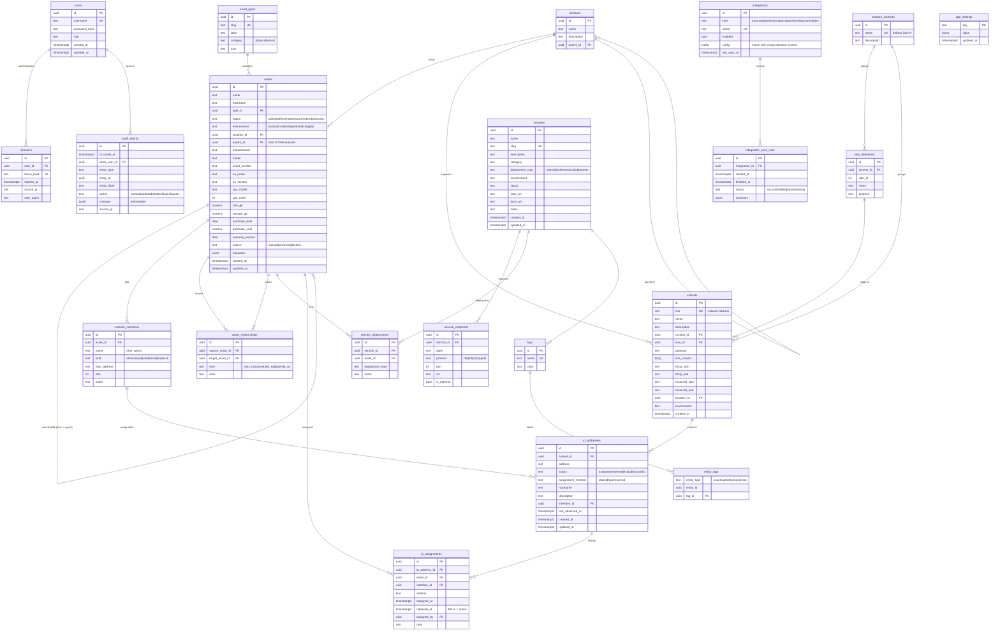

# Lanvory — Architecture

Lanvory is a self-hosted homelab infrastructure & asset management platform: a single source
of truth for physical devices, virtual machines, containers, networks, IP allocations, and services.

Design intent: the data model discipline of NetBox, the asset-inventory ergonomics of Snipe-IT,
and the interface quality of modern developer tools — without enterprise overhead.

---

## 1. High-level architecture

Modular monolith. One Go binary serves the REST API; one React SPA; PostgreSQL is the only
stateful dependency. No message queue, no cache tier, no external SaaS.

```
┌────────────────────────────────────────────────────────────────┐
│  Browser (React SPA — Vite build, served by nginx or dev vite) │
│  TanStack Query · TanStack Table · React Flow · shadcn/ui      │
└──────────────▲─────────────────────────────────────────────────┘
               │ same-origin HTTP(S)  (nginx proxies /api → backend)
┌──────────────┴─────────────────────────────────────────────────┐
│  Go API server (chi)                                           │
│  ┌──────────┐ ┌──────────┐ ┌──────────┐ ┌───────────────────┐  │
│  │ transport│→│ services │→│  store   │→│ PostgreSQL (pgx)  │  │
│  │(handlers,│ │(auth,    │ │(SQL via  │ │  migrations       │  │
│  │ auth mw, │ │ audit,   │ │ pgxpool) │ │  (golang-migrate) │  │
│  │ csrf)    │ │ ipam)    │ │          │ │                   │  │
│  └──────────┘ └──────────┘ └──────────┘ └───────────────────┘  │
│        │                                                       │
│        └── future: integration workers (Proxmox, Docker, …)    │
└────────────────────────────────────────────────────────────────┘
```

### Repository layout

```
lanvory/
├── backend/                  Go API (module github.com/aancw/lanvory)
│   ├── cmd/server/           entrypoint
│   ├── internal/
│   │   ├── api/              chi routes + HTTP handlers (transport layer)
│   │   ├── auth/             password hashing, sessions, auth service
│   │   ├── audit/            audit event recorder
│   │   ├── config/           env-based configuration
│   │   ├── db/               pgxpool bootstrap + embedded migrations
│   │   ├── domain/           shared domain types
│   │   ├── httpx/            middleware, JSON envelope, rate limiting, csrf
│   │   └── store/            SQL queries per aggregate
│   └── Dockerfile
├── frontend/                 React SPA (TypeScript, Vite, Tailwind, shadcn/ui)
│   └── Dockerfile            multi-stage: vite build → nginx static + /api proxy
├── deploy/                   docker-compose.yml, .env.example
├── docs/                     backup/restore, development guide
├── ARCHITECTURE.md           this file
└── ROADMAP.md                phased plan + acceptance criteria
```

---

## 2. Entity-relationship model

The schema below is created in migration `0001_init`. Core inventory tables exist from day one so
later phases extend behavior, not structure.



### Modeling decisions & tradeoffs

| Decision | Rationale / tradeoff |
|---|---|
| PostgreSQL `cidr`/`inet` native types for subnets and IPs | Correct comparison, host/network math in SQL, IPv6-ready for free. Tradeoff: pgx mapping needs care (store as string, parse in Go with `net/netip`). |
| `ip_addresses` = current state per address; `ip_assignments` = append-only history | Keeps allocation queries trivial while preserving history. Active assignment is the row with `released_at IS NULL`; releases update both rows in one transaction. |
| Single `assets` table for physical + virtual | Shared core model per spec; `asset_types.category` (physical/virtual) plus `parent_id` self-FK express host→guest without polymorphism. |
| `network_contexts` (VRF-like) grouping VLANs and subnets | Same VLAN ID / same CIDR can exist in separate contexts without ambiguity. Overlap inside one context is rejected. |
| Generic `entity_tags` (polymorphic, no FK on entity_id) | Spec requires tags across entity kinds; integrity for the polymorphic side is enforced in the service layer (validated entity types, cascade cleanup). Tradeoff accepted vs. per-entity join tables. |
| `audit_events.changes` JSONB | Before/after diffs are schema-flexible by nature; core relationships stay relational. |
| Sessions in Postgres (hashed tokens) | Survives restarts, enables revocation; cheap at homelab scale. Cookie carries a random token; DB stores SHA-256. |
| `app_settings` key/value JSONB | Instance-level settings (name, defaults) without a migration per setting. |
| Migrations embedded via `embed.FS`, applied at startup | Single-binary deployment; golang-migrate runs pending migrations idempotently on boot. |

---

## 3. Backend design

- **Go 1.27**, module `github.com/aancw/lanvory`.
- **chi** router; layered: `api` (transport) → `auth`/`audit`/future services → `store` (SQL).
- **pgx v5** with `pgxpool`; statements are always parameterized.
- **golang-migrate** with migrations embedded from `internal/db/migrations/*.sql`.
- **slog** structured JSON logging (dev: text handler), request ID + latency per request.
- **OpenAPI**: `docs/api/openapi.yaml` documents the REST contract.

### Auth & security

- First run: `GET /api/v1/setup/status` reports whether an administrator exists;
  `POST /api/v1/setup/admin` (only valid while zero users exist) creates it.
- Passwords: **Argon2id** (`alexedwards/argon2id`, OWASP defaults).
- Sessions: 32 random bytes, cookie `lv_session` (`HttpOnly`, `SameSite=Lax`, `Secure` when
  configured); DB stores SHA-256; TTL sliding 14 days; logout deletes server-side.
- **CSRF**: double-submit cookie — `lv_csrf` readable cookie + `X-CSRF-Token` header required on
  all unsafe methods under `/api/v1` (login included).
- Login + setup endpoints are per-IP rate limited (token bucket, 5/min burst 8).
- Security headers on every response; API errors use a uniform `{error: {code, message}}` envelope;
  5xx details never leak internals.
- Audit events recorded for auth and all mutations as phases progress.

### IPAM engine (Phase 3, design locked now)

- Go `net/netip` for prefix math: usable range, next available address, /31 (RFC 3021) and /32
  edge cases, broadcast handling (v4 only).
- DB constraint layer: `UNIQUE (subnet_id, host(address))` + partial-unique index preventing two
  active assignments per address; allocation writes happen in transactions with
  `SELECT … FOR UPDATE` on the subnet row.
- Observed data (future discovery) is stored with source attribution and never overwrites
  operator-declared fields.

---

## 4. Frontend design

- **React 19 + TypeScript (strict)**, Vite, TanStack Query for server state, React Hook Form + Zod
  for forms, TanStack Table for inventory tables (Phase 2+), React Flow for topology (Phase 5).
- **shadcn/ui** components (Radix-based), Tailwind CSS v4, `tw-animate-css` for transitions.
- Design system: neutral zinc surfaces, single restrained accent, `dark`/`light`/`system` theme
  with class strategy, Inter for UI, JetBrains Mono for IPs/MACs/ports/identifiers.
- Layout: persistent sidebar (Overview / Infrastructure / Networking / Administration) exactly per
  spec §5, topbar with global search + quick-add + theme switcher, breadcrumbs.
- API access through a typed fetch client that attaches the CSRF header and normalizes errors;
  TanStack Query keys are stable and cache-aware.

---

## 5. Deployment

- `deploy/docker-compose.yml`: `postgres:17-alpine` (volume `pgdata`, healthcheck), `backend`
  (multi-stage Go build → minimal runtime image), `frontend` (multi-stage node build → nginx
  serving SPA + proxying `/api` to backend). Depends-on with healthcheck conditions.
- Config via env only (`.env.example` documents every variable).
- `backend` runs migrations on start; first visit shows the administrator setup wizard.
- Backup/restore documented in `docs/BACKUP.md`; dev guide in `docs/DEVELOPMENT.md`.
- Seed data lives in `backend/internal/db/seed/` and is applied only via the explicit
  `SEED_MODE=dev` env (never in production images).
