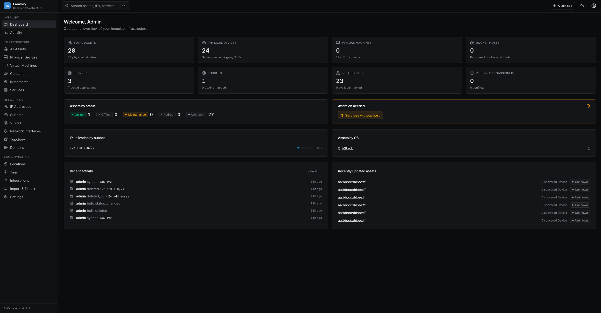

# Lanvory

**A self-hosted inventory for your homelab.** Track physical devices, virtual machines, containers, networks, IP addresses, and the services that run on them.

Lanvory replaces scattered spreadsheets and notes. It runs locally as a Go API, a React web app, and PostgreSQL. No cloud account is required.



## Features

- **Asset inventory:** physical and virtual assets, parent/child hosting, network interfaces, locations, tags, typed relationships, bulk actions, and saved views.
- **IP address management:** subnets, VLANs, an interactive address grid, next-available lookup, bulk reserve/release, assignment history, and IPv4/IPv6 support.
- **Services and topology:** track service endpoints and deployments; build network views from explicit physical, virtualization, and dependency links.
- **Monitoring:** scheduled health checks per endpoint with rolling uptime history (24h/7d), TLS certificate expiry tracking with dashboard alerts, and ntfy-style webhook notifications for downtime, recovery, and expiring certificates.
- **DNS inventory:** manage domains and A, AAAA, CNAME, MX, TXT, SRV, CAA, and NS records; compare declared records with observed DNS state.
- **Integrations:** read-only sync for Proxmox, Docker, Kubernetes, Cloudflare, AdGuard Home, OPNsense (DHCP leases), DNS, and ARP discovery, with optional ICMP checks. Observed data stays separate from operator-maintained fields. Planned connectors are labeled in the UI.
- **Import and export:** preview and map CSV columns before import; export and restore inventory as JSON.
- **Agent access:** an MCP server at `/mcp` exposes CRUD operations to agents using revocable, database-backed tokens. See [the MCP guide](docs/MCP.md).
- **Security and auditing:** Argon2id password hashing, optional TOTP two-factor authentication, multi-user accounts with admin/operator/viewer roles, server-side sessions with per-device visibility and remote sign-out, CSRF protection, rate-limited authentication, webhook alerts for sign-ins from new devices and failed-login bursts, an activity log with optional automatic retention, and encrypted integration secrets.

## Install a standalone binary

Release builds embed the web UI in a single Go binary — PostgreSQL is the only external dependency. Download the archive for your platform from [GitHub Releases](https://github.com/aancw/lanvory/releases), then:

```bash
tar xzf lanvory_<version>_linux_amd64.tar.gz
cp lanvory.toml.example lanvory.toml        # then edit database_url + secret_key
./lanvory                                   # or: ./lanvory -config /etc/lanvory/lanvory.toml
```

The binary reads `./lanvory.toml` or the file given with `-config`; `LV_*` environment variables still work and win over the file. Migrations run automatically on first boot, and the web UI, API, and `/mcp` are all served from one port (default `:8090`, override with `addr`). Set `secret_key` (see `make secret-key`) to enable integration secrets and two-factor authentication. `./lanvory -version` prints the release version.

For ARP scans and ICMP checks on Linux, grant the binary raw-socket access once: `sudo setcap cap_net_raw+ep ./lanvory` (on macOS, run with `sudo` for ARP). See [LAN discovery](#lan-discovery) for the Docker alternative.

## Run with Docker Compose

Docker Compose starts the web app, API, and PostgreSQL database:

```bash
cd deploy
cp .env.example .env
# Review the settings in .env, then start the stack:
docker compose up -d --build
```

Open **http://localhost:8088** and follow the administrator setup wizard. To connect from another device on your LAN, use `http://<host-ip>:8088`. Data persists in the `pgdata` volume.

| Entry point | Address | Use |
| --- | --- | --- |
| Web app | `http://localhost:8088` | Recommended; includes the `/api` proxy |
| API | `http://localhost:8080/api/v1/...` | Direct access for scripts and clients |

For use on a trusted home LAN, the default HTTP setup is sufficient. For access beyond your LAN, put Lanvory behind a TLS-terminating reverse proxy and set `LV_COOKIE_SECURE=true`.

### LAN discovery

For ARP scans, run the backend on the host with `sudo` to access raw packets. Docker users can instead use the [macvlan override](deploy/docker-compose.arp.yml), which requires wired Ethernet and does not work over Wi-Fi or Docker Desktop. Compose also grants the backend `NET_RAW` for ICMP checks.

## Develop locally

With Go, Node.js, and Docker installed, run:

```bash
make dev
```

This starts PostgreSQL, the API on port `8090`, and the Vite development server on port `5173`. See [Development](docs/DEVELOPMENT.md) for setup, tests, and repository conventions.

## Documentation

- [Development and testing](docs/DEVELOPMENT.md)
- [Backup and restore](docs/BACKUP.md)
- [Architecture and ERD](ARCHITECTURE.md)
- [REST API contract](docs/api/openapi.yaml)
- [MCP server](docs/MCP.md)
- [Roadmap](ROADMAP.md)

## Security notes

- PostgreSQL is only reachable on the internal Compose network.
- Enable `LV_COOKIE_SECURE=true` when serving over HTTPS.
- Integration secrets are encrypted at rest and are never returned by the API. Do not store service credentials in Lanvory's inventory fields.
- Login and setup endpoints are rate-limited, and security-relevant changes are recorded in the audit log.
